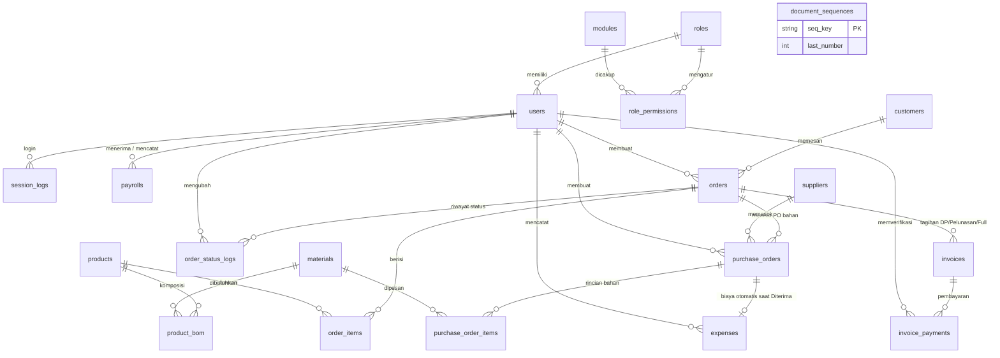

# Entity Relationship Diagram (ERD) — Kelo-ERP

Diagram berikut merangkum 20 tabel dalam `prisma/schema.prisma` untuk UMKM Keloria.

## Ringkasan Keputusan Skema
- Semua nominal uang menggunakan `Decimal(12, 2)` (tidak pernah `Float`).
- Relasi transaksi memakai `onDelete: Restrict` untuk mencegah kehilangan histori keuangan/pesanan.
- `users` (`status: Nonaktif`), `products` (`is_active: false`), `customers` (`is_active: false`), `materials`, dan `suppliers` menggunakan **soft-delete**.
- `expenses.po_id` bertipe `unique` (nullable) untuk menjamin pembuatan biaya otomatis `Pembelian Supplier` saat PO `Diterima` bersifat **idempoten** (tidak pernah dobel).
- `document_sequences` menjamin penomoran dokumen (`ORD-YYYYMM-0001`, `INV-YYYYMM-0001`, `PO-YYYYMM-0001`) aman dari race condition di dalam `prisma.$transaction`.
